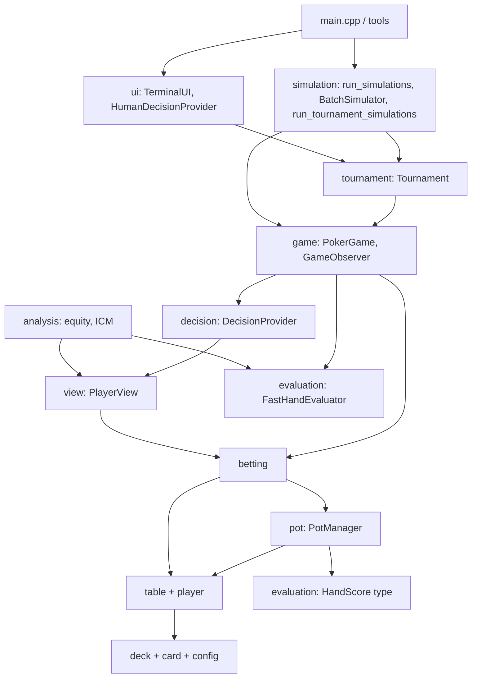

# Architecture

## Directory layout

```
poker/
├── main.cpp                 Interactive CLI entry point
├── CMakeLists.txt           Build definition (libraries, executables, tests)
├── config/                  Capacities (MAX_PLAYERS = 8 …) and GameConfig
├── card/                    Card, Face, Suit, string formatting
├── deck/                    Fixed 52-card deck with shuffle/deal/burn
├── player/                  Per-seat state (cards, cash, in_hand, all_in)
├── table/                   Table struct + dealing, button and blind helpers
├── pot/                     Contributions, side-pot layers, payouts
├── betting/                 Legal actions, validation, applying actions
├── view/                    PlayerView: what one player is allowed to see
├── decision/                DecisionProvider interface, simple AI, human input
├── game/                    PokerGame state machine, GameObserver, snapshots
├── evaluation/              Reference evaluator + fast lookup-table evaluator
├── data/                    hand_tables.bin (pre-generated lookup data)
├── tournament/              Single-table freezeout on top of PokerGame
├── simulation/              Parallel experiments, batching, sampler, encoding
├── analysis/                Monte Carlo equity and ICM
├── ui/                      TerminalUI (observer + input)
├── tools/                   Benchmarks, validation, table generator, runners
├── tests/                   Seven test executables registered with CTest
└── documentation/           This library
```

## Layers

Dependencies point downward only. Higher layers never reach around lower ones
to change rules.



Build-wise there are two libraries: **`poker_engine`** (everything headless)
and **`poker_terminal`** (`TerminalUI` + `HumanDecisionProvider`). Simulation
code never links terminal code.

## Key design principles

These recur throughout the source comments and explain most design choices.

1. **One rules implementation.** Interactive play, provider-driven play,
   externally stepped play and batched play all go through the same
   `PokerGame` state machine (`advance_to_decision` / `apply_action`). Betting
   mutations go through one function, `detail::apply_validated_decision`.
2. **Information hiding.** Strategies receive a `PlayerView` containing only
   their own hole cards and public state. Only trusted `GameObserver`s see the
   full `Table`.
3. **Validate at the boundary, trust inside.** Decisions are validated against
   cached `LegalActions`; the fast evaluator's `evaluate_unsafe` does no checks
   because the deck guarantees valid, distinct cards.
4. **No hot-path allocation.** Fixed-size `std::array`s sized by
   `MAX_PLAYERS`, reusable buffers in samplers and batchers, history disabled
   by default.
5. **Reproducibility.** Every game has an explicit seed. Simulations derive
   per-episode and per-seat seeds with SplitMix64 (`simulation_seed`), so
   results do not depend on worker count or scheduling. Checksums verify this.
6. **Borrowed dependencies.** Providers, observers and evaluators are passed by
   reference/pointer and must outlive their users; nothing takes ownership
   except the simulation runners' factories.
7. **Integer chips.** Chips are `int`, prizes are `std::int64_t`. Configs are
   bounded so `current_bet + minimum_raise_size` cannot overflow.

## How one hand flows

```mermaid
sequenceDiagram
  participant C as Caller
  participant G as PokerGame
  participant B as Betting
  participant P as PotManager
  participant E as FastHandEvaluator
  C->>G: begin_hand()
  G->>G: start_new_hand (reset deck, shuffle, deal hole cards)
  G->>P: post_blinds (contribute SB, BB)
  loop until hand ends
    C->>G: advance_to_decision()
    G->>B: next_player_needing_action
    alt someone must act
      G-->>C: true; current_view() gives PlayerView
      C->>G: apply_action(decision)
      G->>B: validate + apply_validated_decision
      Note over G: only one player left → award_entire_pot
    else street complete
      G->>G: deal flop / turn / river, reset round
    end
  end
  G->>E: evaluate 7 cards per remaining player
  G->>P: build_pots → distribute_pots
  G->>G: finish_hand (rewards, rotate dealer)
```

`play_one_hand()` is just this loop with `DecisionProvider`s answering each
`current_view()`.

## Threading model

- A `PokerGame`, `Tournament` or `BatchSimulator` belongs to one thread at a
  time.
- `FastHandEvaluator` data is immutable after loading and is shared freely;
  `default_fast_hand_evaluator()` is a thread-safe function-local static.
- `run_simulations` / `run_tournament_simulations` create one game and one set
  of providers **per worker**, stride episode IDs across workers, keep
  per-worker totals in cache-line-aligned slots, and rethrow the first worker
  exception after all threads join.
